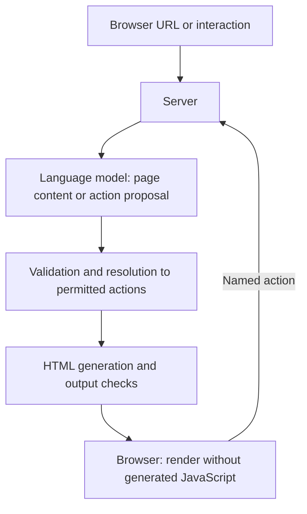

# laadan-engine

**An LLM web runtime with static action listeners and provable execution safety**

## Láadan

Láadan is a constructed language created by linguist and feminist author Suzette Haden Elgin. Developed in 1982 as a language for women, it was designed around radical transparency: its grammar makes intent and the source of knowledge explicit. `laadan-engine` applies a related idea to web interactions: actions are intended to be named explicitly and handled by the server, rather than hidden in generated code.

## Concept

The system is intended to use a language model to propose page content as HTML and refer to existing actions. Interactions are intended to return to the server as named requests, where inputs are validated and actions are resolved only against an application-defined set. Model-generated content is treated as untrusted.

This diagram presents an initial direction, not an implemented architecture. Components, technologies, and security controls remain subject to revision. It is not a security guarantee.

## Status

The project is at the concept stage; no working system has been implemented. A preliminary outline is available in [docs/architecture.md](docs/architecture.md).

## Coding agents

Shared rules for Copilot and Antigravity are in [AGENTS.md](AGENTS.md). Copilot also uses [`.github/copilot-instructions.md`](.github/copilot-instructions.md).

## License

See [LICENSE](LICENSE).
