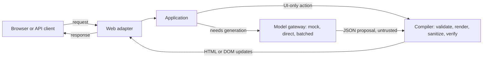

# laadan-engine

**A server-driven runtime for model-generated web interfaces, designed so that model output is never executed.**

[](LICENSE)
[](#roadmap)
[](pyproject.toml)

---

## Overview

`laadan-engine` is an experimental vibe-server: open any route in a browser (`/whatsapp`, `/kanban`), click a button, or send a request with `curl` or Postman, and the server generates a page, a partial page update, or a JSON response on the fly.

The obvious way to build this is to let a language model write HTML and JavaScript and pass it to the browser. Every hallucination or prompt injection then becomes code running in the browser.

This project draws one hard line:

> The model produces data, never code. The server validates that data against a fixed set of components and renders all HTML itself.

The browser runs one small, fixed script. Generated pages contain no model-written scripts, event handlers, styles, or external URLs.



## How model output is contained

1. **Typed output.** The model returns JSON that must match a closed component schema (Pydantic v2). Anything else is rejected.
2. **Server-side rendering.** HTML comes only from the project's own Jinja2 templates with autoescaping. Model text is escaped; model-chosen values such as colors or sizes must match fixed patterns or lists.
3. **One narrow door for formatting.** `RichText` nodes may contain a few formatting tags. They are cleaned by `nh3` with a minimal allowlist.
4. **Output check.** Before anything leaves the server, the final HTML is parsed again with `selectolax` and checked for forbidden constructs.
5. **Browser backstop.** A strict Content Security Policy blocks inline scripts, inline styles, and requests to other origins.
6. **Server-owned actions.** Buttons carry only an ID. What a button does is stored on the server, not in the page.

Details, including what this design does not cover: [`docs/security-model.md`](docs/security-model.md).

---

## Láadan
**Láadan** is a constructed language created in 1982 by linguist and feminist author Suzette Haden Elgin. Designed around radical transparency, its grammar requires speakers to make both their intent and their source of knowledge explicit through mandatory evidential markers. `laadan-engine` applies a related principle to generative web interfaces: a Láadan sentence can carry an *evidential*: a small word stating how the speaker knows what they say. The engine borrows three of them to label where data comes from:

| Evidential | Meaning in Láadan | Meaning in `laadan-engine` |
| :--- | :--- | :--- |
| `wa` | perceived by the speaker | User input: form values, route paths, API request bodies |
| `we` | perceived in a dream | Anything produced by the model |
| `wi` | self-evident | Content produced by the server itself |

Model output is treated like a dream: possibly vivid, never trusted. The labels travel with stored data and show up in prompts and logs, so a contact the model invented on `/whatsapp` is still marked as dreamed when it reappears on `/instagram`. Security does not depend on these labels; it depends on the typed pipeline above.

**Carrier Bag.** The model gets a bag of prebuilt, safe components to carry its ideas in, instead of a spear to throw at the browser. The image is borrowed from Ursula K. Le Guin's essay *The Carrier Bag Theory of Fiction*. In code, the component catalog is the carrier bag.

**Agentic Action Listeners** are ordinary event listeners, agentified for the occasion: declarative `data-laadan-*` attributes that one fixed script turns into structured requests to the server.

---

## Planned Features

* **Typed component tree.** Pages are trees of components (`Section`, `Card`, `Button`, `TextInput`, `Table`, ...) instead of HTML strings. No HTML-in-JSON escaping problems.
* **Partial updates.** Actions return either a full page or a short list of DOM operations (`replace`, `append`, `prepend`, `remove`) that the client applies without reloading.
* **Zero-LLM fast path.** Pure UI actions such as toggles and tab switches are handled by the server without a model call.
* **Shared memory across apps.** Generated apps store entities (contacts, messages, tasks) in a shared SQLite store. A contact created on `/whatsapp` can appear on `/instagram`.
* **Progressive asset discovery.** The model sees a short list of asset categories and can ask once for the entries it needs. It references images by ID (`asset:icon-chat`), never by URL.
* **Model modes for rate limits.** Set in `.env`: `mock` (default, offline fixtures), `direct` (one call per generation), `batched` (bursts of actions combined into one call). All modes share a requests-per-minute limit.
* **Per-app themes.** Each generated app can pick colors, radius, font, and density from bounded tokens.
* **Static start page.** `/` serves a static `index.html` that explains the project.

---

## Repository Structure

The code follows a ports-and-adapters layout. The `compiler` package is the security core: every byte of HTML that reaches a browser passes through it.

```text
laadan-engine/
├── docs/
│   ├── architecture.md          # Components, request flows, model modes, formal core
│   ├── security-model.md        # Threats, controls, limits, residual risks
│   └── page-document-spec.md    # Component catalog and action protocol (draft)
├── src/laadan/
│   ├── domain/                  # Pydantic models: components, actions, entities, evidentials, limits
│   ├── compiler/                # Validate, render (Jinja2), sanitize (nh3), verify (selectolax)
│   ├── application/             # Use cases, ports, context building, rate limiting, batching
│   └── adapters/
│       ├── web/                 # FastAPI app, security headers, origin checks, static files, client script
│       ├── models/              # Mock gateway (default) and OpenAI-compatible HTTP gateway
│       └── storage/             # SQLite entity store and page store
├── tests/
│   ├── unit/
│   ├── integration/             # Request and action flows against the mock gateway
│   └── security/                # Hostile model outputs and output-check tests
├── .env.example                 # Local configuration template (loopback, mock mode)
├── pyproject.toml
└── AGENTS.md                    # Working rules for contributors and coding assistants
```

---

## Roadmap

The repository currently contains design documents and the package skeleton. There is no runtime code yet.

* [x] **Phase 0: Design and skeleton.** Architecture, security model, component draft, package layout, tooling config.
* [ ] **Phase 1: Safe core.** Domain models, compiler (render, sanitize, verify), static `index.html`, mock gateway, hostile-output test suite.
* [ ] **Phase 2: Client and actions.** Client script, action endpoint, fast path, partial updates.
* [ ] **Phase 3: Generated routes and model modes.** Arbitrary routes, JSON API mode, `direct` and `batched` modes, rate limiter.
* [ ] **Phase 4: Shared memory and assets.** Cross-app entity store, asset catalog with progressive discovery.

---

## License

Licensed under the [Apache License, Version 2.0](LICENSE).
