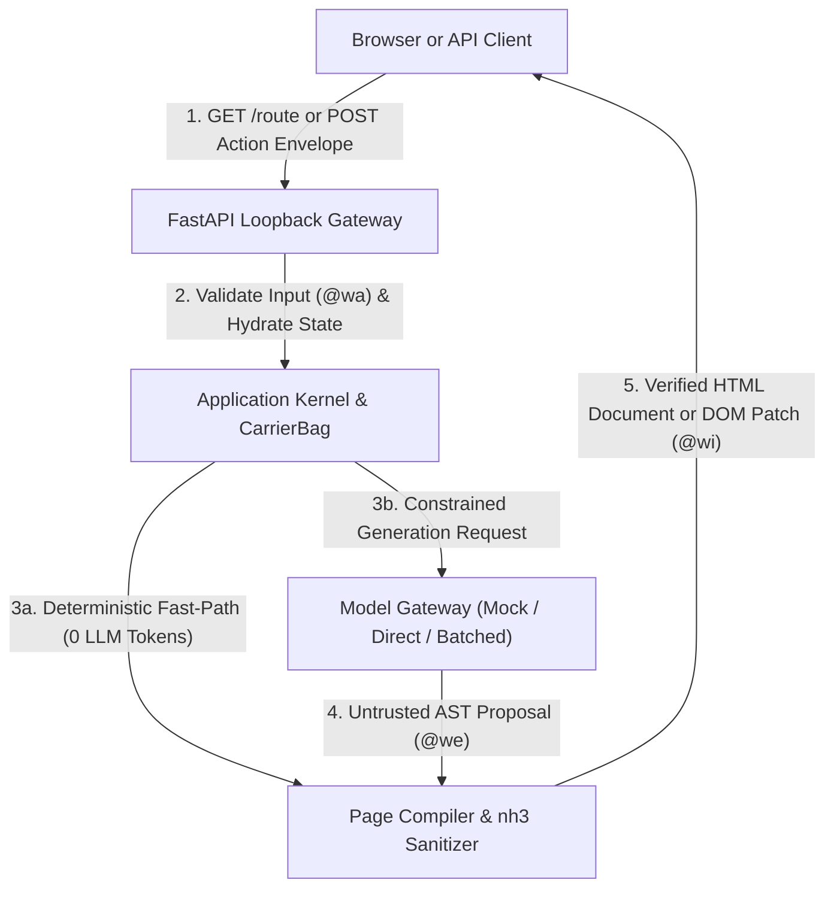

# laadan-engine

**A deterministic, server-driven web runtime for generative web interfaces with zero-eval client safety**

[](LICENSE)
[](#roadmap)
[](pyproject.toml)

---

## Overview

`laadan-engine` is an experimental "vibe-server" runtime: navigate to any route in a browser (`/whatsapp`, `/instagram`, `/kanban`), click a button, or send an arbitrary request via Postman or `curl`, and the server dynamically generates interactive web pages, partial DOM updates, or structured API responses on the fly.

Most generative web experiments achieve interactivity by letting a language model emit raw HTML and executable JavaScript (`eval`, inline `onclick` handlers, dynamic `<script>` tags). That approach turns every prompt injection or hallucination into Cross-Site Scripting (XSS), UI redressing, or data exfiltration.

`laadan-engine` enforces a strict architectural boundary: **The language model never emits executable code. It proposes structured data and component trees, while the server handles validation, state transitions, and HTML rendering.**



---

## Naming & Core Metaphor: Why "Láadan"?

**Láadan** is a constructed language created in 1982 by linguist and feminist author Suzette Haden Elgin. Designed around radical transparency, its grammar requires speakers to make both their intent and their source of knowledge explicit through mandatory evidential markers.

`laadan-engine` applies a related principle to generative web interfaces: instead of concealing intent inside opaque, model-generated client scripts, user and model interactions are named explicitly as structured actions, typed by evidential origin, and executed deterministically on the server:

1. **Evidential Typing (`@we` $\rightarrow$ `@wi`)**: Language models generate plausible-sounding hallucinations with the same syntactic confidence as facts. In `laadan-engine`, every model output is typed as `@we` (`Evidence.CONJECTURAL` - *"seen in a dream"*). A `@we` value carries zero execution privilege and cannot mutate state or reach the browser until deterministic server compilation and sanitization promote it to `@wi` (`Evidence.VERIFIED`).
2. **The Carrier Bag vs. The Spear**: Rather than handing a model a "spear" (arbitrary JS `eval`, shell execution, or unconstrained tool calls), the runtime acts as a **Carrier Bag**: a bounded container of pre-verified UI components, validated theme tokens, and shared cross-route state.
3. **Agentic Action Listeners (`data-laadan-*`)**: Instead of model-generated scripts, the browser runs a fixed, tiny Vanilla JS client (`laadan-client.js`, ~4 KB). Interactive elements use declarative `data-laadan-*` attributes that gather context (button payloads, form inputs, target DOM selectors) and send a structured request to the server, which responds with either a full page or targeted DOM mutations (live DOM morphing without full page reloads).

---

## Planned Architecture & Capabilities

* **Typed Component AST + Rust Sanitization (`nh3`)**: To avoid broken HTML-inside-JSON escaping, models emit a typed `PageDocument` tree (`Container`, `Card`, `ActionTrigger`, `TextInput`, `Table`, etc.) validated via Pydantic v2 discriminated unions. Free-text rich formatting is sanitized through `nh3` (Python bindings to Rust's `ammonia`) and inspected with `selectolax`.
* **Safe Visual Freedom (Bounded Theme Tokens)**: Raw `<style>` tags and `url(...)` rules are blocked to prevent CSS data exfiltration. To keep generated apps visually distinct, models can supply bounded theme tokens (validated hex colors, spacing, and layout presets) compiled into safe `--ldn-*` CSS custom properties alongside a utility class allowlist.
* **Two-Tier Action Dispatch**:
  * **Deterministic Fast-Path**: Pure UI state changes (tab switches, accordions, local state toggles) resolve server-side in milliseconds without calling the LLM.
  * **Generative Intent Actions**: Open-ended domain actions on synthetic routes (e.g., creating a contact or sending a message) pass a schema-validated envelope to the model and state store-enabling arbitrary interactive apps without hardcoding Python controllers for every button.
* **Cross-App Memory (`CarrierBag`)**: Endpoints retain their state and share a relational SQLite entity store. For example, a contact created on `/whatsapp` is stored in the `CarrierBag` and automatically appears when navigating to `/instagram`.
* **Progressive Resource Discovery**: Instead of stuffing hundreds of asset descriptions into every prompt, the model can query a local, hash-verified asset catalog (SVGs, icons, dimensions) on demand and embed them via symbolic IDs (`asset:icon-shield`), preventing SSRF and broken external links.
* **Rate-Limit Execution Modes**: Configurable via `.env` to handle strict provider RPM limits:
  * `mock`: Offline deterministic fixtures with zero API cost and zero network access (Default).
  * `direct`: Synchronous model calls for immediate generation.
  * `batched`: Debounced action coalescing buffer that bundles rapid user clicks into single model requests.
* **Static Anchor (`index.html`)**: The root route `/` serves a static landing page explaining the engine and providing a safe starting point before branching into dynamically generated routes.

---

## Repository Structure

The codebase is organized around **Ports and Adapters (Hexagonal Architecture)**:

```text
laadan-engine/
├── docs/                           # Architecture specifications and protocol blueprints
│   ├── architecture.md             # System design, formal state model, and layer contracts
│   ├── security-model.md           # Threat model, sanitization pipeline, and CSP boundaries
│   └── page-document-spec.md       # Typed Component AST and Agentic Action Listener spec
├── src/
│   └── laadan/
│       ├── domain/                 # Core entities, evidential types (@wa..@wi), CarrierBag contracts
│       ├── application/            # Routing, action coalescing, fast-path dispatch, page compiler
│       └── adapters/               # Inbound and outbound technical adapters
│           ├── web/                # Inbound: FastAPI loopback gateway, static index.html, client JS
│           ├── models/             # Outbound: MockModelGateway and HTTP LLM provider clients
│           ├── storage/            # Outbound: SQLite CarrierBag store and session cache
│           └── security/           # Outbound: nh3 sanitizer, selectolax inspector, token allowlists
├── tests/
│   ├── unit/                       # Fast unit tests for domain types, AST schemas, and sanitizers
│   ├── integration/                # End-to-end request/action flows using MockModelGateway
│   └── security/                   # XSS, CSS exfiltration, DOM clobbering, and fuzzing suites
├── .env.example                    # Local environment template (defaults to loopback + mock mode)
├── pyproject.toml                  # Dependencies and strict tooling config (mypy, ruff, pytest)
└── AGENTS.md                       # Working agreement and safety rules for contributors and AI tools
```

---

## Roadmap

This repository currently contains the **Phase 0 architecture specification and project skeleton**. Implementation proceeds iteratively across four milestones:

* [x] **Phase 0: Architecture Blueprint & Package Skeleton** (Current commit - specs, schemas, directory structure, tooling config)
* [ ] **Phase 1: Minimal Safe Kernel** (FastAPI loopback server, static `index.html`, Pydantic AST models, `nh3` sanitizer, `MockModelGateway`)
* [ ] **Phase 2: Client Runtime & Agentic Action Listeners** (`laadan-client.js`, `data-laadan-*` context gathering, partial DOM morphing)
* [ ] **Phase 3: Dynamic Vibe Routing & Rate-Limit Coalescer** (Arbitrary browser/API routes, `direct` and `batched` execution modes, Zero-LLM Fast-Path)
* [ ] **Phase 4: CarrierBag Cross-App Memory & Progressive Asset Discovery** (SQLite cross-route entity persistence, token-efficient symbolic asset catalog)

Detailed specifications live in [`docs/architecture.md`](docs/architecture.md), [`docs/security-model.md`](docs/security-model.md), and [`docs/page-document-spec.md`](docs/page-document-spec.md).

---

## License

Licensed under the [Apache License, Version 2.0](LICENSE).
