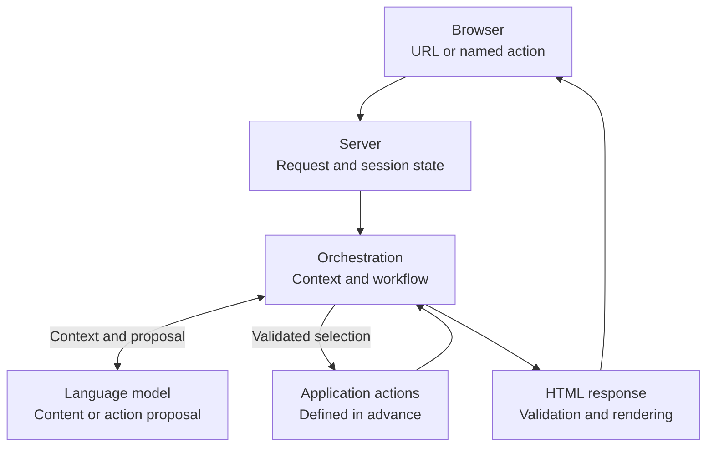

# Preliminary architecture concept

This document outlines the current concept. It does not describe an existing implementation or a final architecture. Components and workflows are expected to evolve as the project develops.

## Core concepts

- Page content is intended to be generated at runtime with language-model assistance.
- Interactions are intended to be submitted to the server as named requests; the model is not to provide executable browser JavaScript.
- Actions and tools are intended to be defined by the application and constrained on the server.
- User input, stored state, and model responses are treated as untrusted.
- Context and session state are intended to be selected and managed separately.
- Model access, external connections, and persistent storage remain optional and undecided.