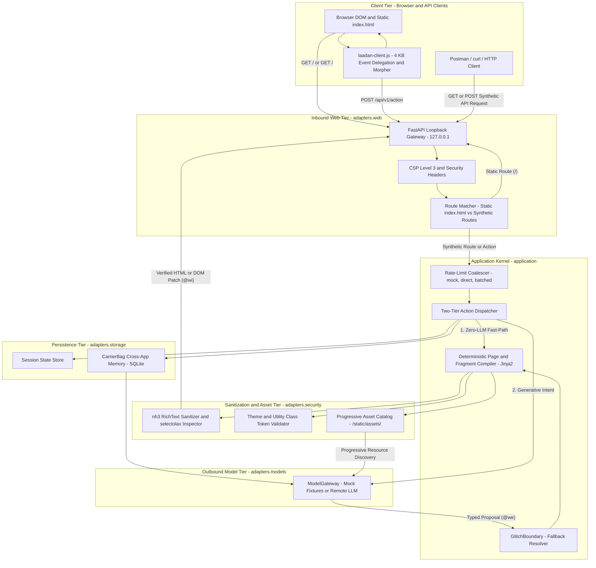

# System Architecture: Láadan Engine

**Status:** Design Proposal (Phase 0 Blueprint)  
**Scope:** Runtime Kernel, Evidential Type System, State Persistence, and Execution Modes  

---

## 1. Architectural Goal

`laadan-engine` is designed as a generative web and API server ("vibe-server") that responds to arbitrary browser navigation (`GET /whatsapp`, `GET /instagram`, `GET /kanban`), interactive UI clicks (`POST /api/v1/action`), and synthetic API calls (from Postman, `curl`, or HTTP clients) by generating working interfaces and state transitions on the fly.

The central engineering constraint is **Zero Eval with Maximum UI Capability**:
* The client browser never executes model-generated JavaScript, inline event handlers, or unvalidated CSS.
* At the same time, generated applications are not limited to static text: they support interactive forms, partial DOM morphing without full-page reloads, custom per-app visual theming, cross-app shared memory, and open-ended domain actions.

### Core System Invariants

1. **Zero Client-Side Code Generation:** The browser runs a single, fixed Vanilla JS runtime (`laadan-client.js`, ~4 KB) using event delegation (`data-laadan-*` attributes) and live DOM morphing. The language model emits zero executable scripts.
2. **Evidential Taint Tracking (`@we` → `@wi`):** All model output starts as conjectural data (`@we`). It cannot mutate state or reach the client until validated and compiled by deterministic server code into verified output (`@wi`).
3. **Two-Tier Capability Dispatch:** Client actions resolve either through a deterministic server-side **Fast-Path** (zero LLM tokens) or through a schema-bounded **Generative Intent Handler** that updates state and requests a typed UI patch from the model.
4. **Loopback & Offline by Default:** The server binds to `127.0.0.1` and defaults to `LAADAN_EXECUTION_MODE=mock`. External LLM calls are opt-in.

---

## 2. Container & Request Flow Architecture



---

## 3. Evidential Type System & Formal Runtime Model

Created in 1982 by linguist and feminist author Suzette Haden Elgin, the constructed language **Láadan** requires every statement to carry an evidential morpheme indicating how the speaker knows the claim to be true. `laadan-engine` adapts this principle into a taint-tracking type system across the request lifecycle:

| Morpheme | Enum Member | Literal Meaning in Láadan | Meaning in `laadan-engine` |
| :--- | :--- | :--- | :--- |
| **`@wahel`** | `Evidence.UNTRUSTED` | No evidence / ungrounded | Raw incoming HTTP bytes, query strings, and unparsed JSON payloads before validation. |
| **`@wa`** | `Evidence.PERCEIVED` | Directly perceived by senses | Schema-validated user interactions (`ActionEnvelope`, form values, route parameters). |
| **`@we`** | `Evidence.CONJECTURAL` | **Perceived in a dream** | Raw LLM output (`PageDocument` AST proposal, entity updates). Treated as a hallucination until checked. |
| **`@wi`** | `Evidence.VERIFIED` | Self-evident / proven | Deterministically compiled HTML fragments, sanitized rich text, and committed `CarrierBag` state. |

### Formal State Transition & Type Promotion

To make the boundary between probabilistic model outputs and deterministic execution explicit, the runtime can be viewed as a typed state machine over application state $S_t$ (the `CarrierBag`) and client view $V_t$:

#### Ingress Parsing (`@wahel` → `@wa`)
An incoming raw request $r \in \mathcal{T}_{\text{wahel}}$ is parsed by a strict Pydantic validator $\phi_{\text{in}}$:

$$
a_{\text{wa}} = \phi_{\text{in}}(r)
$$

If validation fails, the request is rejected at the gateway before touching state or models.

#### Two-Tier Dispatch: Fast-Path vs. Generative Path

**Deterministic Fast-Path:** If the action $a_{\text{wa}}$ uses a local UI primitive (such as `ui.toggle` or `ui.switch_tab`), the transition function $\delta_{\text{fast}}$ computes the next state and view directly without calling the model:

$$
(S_{t+1}, V_{t+1}^{\text{wi}}) = \delta_{\text{fast}}(S_t, a_{\text{wa}})
$$

**Generative Path:** For open-ended routes or domain intents, the model gateway $M$ proposes a candidate AST and state delta typed as conjectural (`@we`):

$$
p_{\text{we}} \sim M(S_t, a_{\text{wa}}, C_{\text{assets}})
$$

Because $p_{\text{we}} \in \mathcal{T}_{\text{we}}$ ("seen in a dream"), it cannot be sent to the browser directly. It must pass through the deterministic compiler $\kappa$ (Pydantic AST validation + `nh3` sanitization + asset resolution), with fallback boundary $B_{\text{glitch}}$ on failure:

$$
(S_{t+1}, V_{t+1}^{\text{wi}}) = 
\begin{cases} 
\kappa(S_t, p_{\text{we}}) & \text{if } p_{\text{we}} \text{ is valid} \\
(S_t, B_{\text{glitch}}(p_{\text{we}})) & \text{otherwise} 
\end{cases}
$$

#### Rate-Limit Coalescing (`batched` mode)
When a user triggers a burst of actions $(a_1, a_2, \dots, a_k)$ within a debounce window $\Delta t$ (e.g. 250 ms), the coalescing buffer folds them into a single composite intent before invoking $M$ once, keeping request volume within strict provider RPM limits:

$$
\tilde{a} = a_1 \oplus a_2 \oplus \dots \oplus a_k
$$

---

## 4. Core Subsystems in Detail

### 4.1 Static Anchor (`index.html`) vs. Synthetic Vibe Routes
* **Root Anchor (`GET /`):** Serves a static `index.html` landing page that explains the engine, displays runtime status (current execution mode, active `CarrierBag` entities), and offers entry links into synthetic routes.
* **Synthetic Browser Routes (`GET /<app-name>`):** Any path not matching `/static/*` or `/api/*` is treated as a synthetic application route. If the route already has cached structure in the session, it hydrates from state; otherwise, it generates a fresh `PageDocument` AST tailored to that route.
* **Synthetic API Endpoints (`Accept: application/json`):** Requests from Postman, `curl`, or scripts targeting arbitrary paths can receive structured, schema-validated JSON responses backed by the same `CarrierBag` state store, making it possible to test backend endpoints and browser UIs against the same shared data.

### 4.2 Cross-App Memory (`CarrierBag`)
Instead of isolating every generated page in a throwaway prompt, `laadan-engine` persists domain objects in a shared SQLite store called the **`CarrierBag`**:
* Entities are stored as typed records (`EntityNode`: e.g., `contact`, `message`, `note`, `task`, `profile`) with JSON attributes and provenance metadata (`created_by_route`, `evidence`).
* **Example Flow:** A user opens `/whatsapp` and creates a contact *"Ada Lovelace"* via an Agentic Action Listener. The action stores the `contact` entity in the `CarrierBag`. When the user later navigates to `/instagram` or queries `GET /api/contacts` in Postman, the kernel injects the relevant `CarrierBag` entities into the model context so *"Ada Lovelace"* appears consistently across applications.

### 4.3 Progressive Resource Discovery (`AssetCatalog`)
Allowing an LLM to invent external `` URLs leads to broken images, tracking pixels, or Server-Side Request Forgery (SSRF). Conversely, pasting a catalog of 500 local icons into every system prompt wastes context tokens.
* `laadan-engine` uses **Progressive Resource Discovery**: the local `/static/assets/` catalog indexes verified SVGs and images by category, tags, aspect ratio, and dimensions.
* During generation, the kernel provides only compact category summaries or matches relevant to the route intent (e.g., chat icons for `/whatsapp`, media cards for `/instagram`).
* The model references assets symbolically (`{"type": "Asset", "props": {"id": "asset:avatar-default"}}`), and the `PageCompiler` resolves them to local, hash-verified static files (or a safe fallback SVG if an ID does not exist).

### 4.4 Rate-Limit Modes (`mock`, `direct`, `batched`)
Configured via `LAADAN_EXECUTION_MODE` in `.env`:
* **`mock` (Default):** Uses `MockModelGateway` with deterministic local fixtures. Requires zero API keys, makes zero network calls, and runs integration tests at full speed.
* **`direct`:** Sends each generative request directly to the configured LLM provider with retry/backoff.
* **`batched`:** Queues rapid UI actions in an asynchronous coalescing buffer (`LAADAN_ACTION_COALESCE_DEBOUNCE_MS=250`), merging intermediate clicks or filter changes into one batched LLM call to respect tight requests-per-minute (RPM) quotas.

---

## 5. Layer Responsibilities (Ports & Adapters)

```text
[ Inbound Adapters: FastAPI Web Gateway, Static index.html, laadan-client.js ]
                                     │
                                     ▼
[ Application Layer: Route Dispatcher, Coalescer, Action Router, PageCompiler ]
                                     │
                                     ▼
[ Domain Layer: Evidential Types (@wahel..@wi), AST Models, CarrierBag Entities ]
                                     ▲
                                     │
[ Outbound Adapters: Models (Mock/HTTP), Storage (SQLite), Security (nh3/selectolax) ]
```

* **`src/laadan/domain/`:** Pure Python and Pydantic v2 models with zero I/O or web framework imports. Defines `Evidence`, `PageDocument` AST nodes, `ActionEnvelope`, and `CarrierBag` entity contracts.
* **`src/laadan/application/`:** Orchestrates the request lifecycle: `SemanticRouter`, `ActionCoalescer` (rate-limit batching), `FastPathDispatcher` (zero-LLM UI updates), `PageCompiler` (Jinja2 rendering), and `GlitchBoundary`.
* **`src/laadan/adapters/web/`:** FastAPI loopback gateway (`127.0.0.1`), CSP headers, static `index.html`, and the ~4 KB `laadan-client.js` script.
* **`src/laadan/adapters/models/`:** `ModelGateway` port implementations (`MockModelGateway` and OpenAI-compatible structured output clients).
* **`src/laadan/adapters/storage/`:** SQLite repository for `CarrierBag` cross-app persistence and in-memory session state.
* **`src/laadan/adapters/security/`:** `nh3` (Rust `ammonia`) sanitizer for `RichText` fragments, `selectolax` (C `lexbor`) parser for fast server-side HTML tree inspection and test assertions, and allowlist validators for CSS utility classes and theme tokens.

---

## 6. Related Specifications

* Threat model, sanitization pipeline, and CSS/CSP boundaries: [`docs/security-model.md`](security-model.md)
* Typed Component AST schema and Agentic Action Listener wire protocol: [`docs/page-document-spec.md`](page-document-spec.md)
