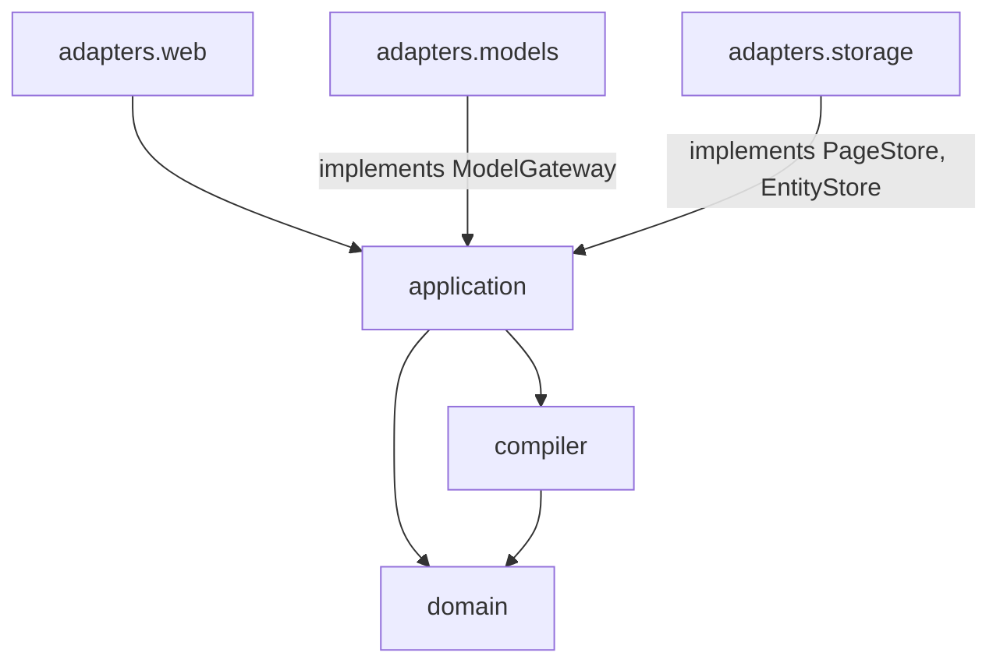
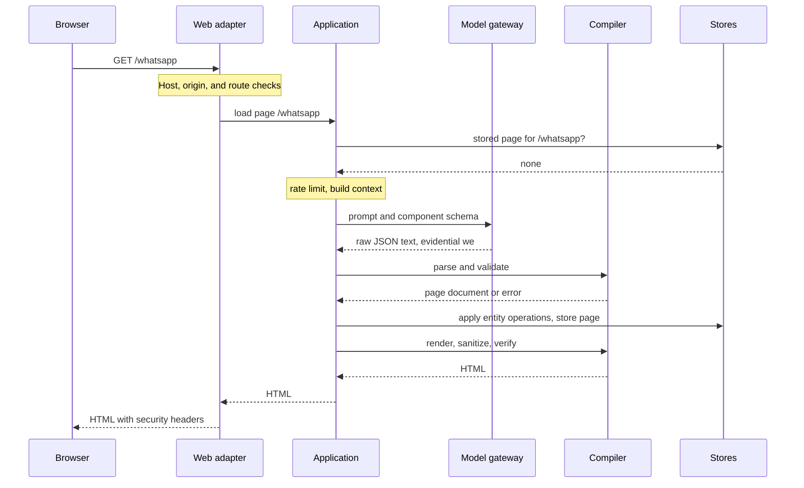
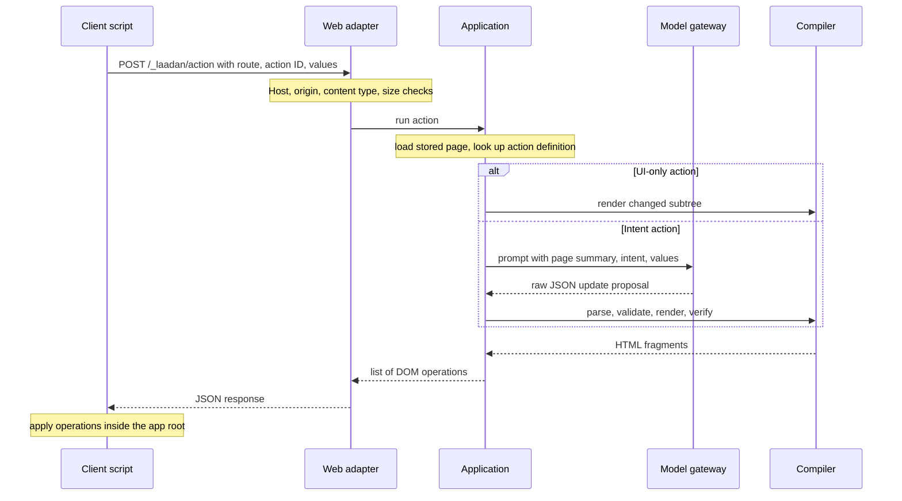

# Architecture

**Status:** Design proposal. Nothing described here is implemented yet.

---

## 1. Goal and Constraints

`laadan-engine` answers arbitrary requests (browser navigation, button clicks, API calls) with generated pages, partial page updates, or JSON responses.

Fixed constraints:

* **Model output is data.** It is parsed as JSON into typed models and never executed, evaluated, or used as template source, SQL, file path, or URL to fetch.
* **The server renders all HTML.** The browser runs one fixed script and receives only HTML produced by application-owned templates.
* **Local and offline by default.** The server binds to `127.0.0.1`, and the default model mode is `mock`, which makes no network calls.
* **Single local user in v1.** There are no accounts or sessions. Multi-user operation is out of scope for v1 (see [security model, section 9](security-model.md#9-residual-risks-and-later-work)).

---

## 2. Packages (Ports and Adapters)

| Package | Responsibility | May import |
| :--- | :--- | :--- |
| `domain` | Pydantic models: components, page documents, actions, entity operations, theme tokens, evidentials, limits. No I/O. | Pydantic |
| `compiler` | Security core. Turns validated domain objects into HTML: render (Jinja2), sanitize `RichText` (nh3), verify output (selectolax). No network, storage, or model access. | `domain`, Jinja2, nh3, selectolax |
| `application` | Use cases (load page, run action, answer API request), context building, rate limiting, batching. Defines the ports. | `domain`, `compiler` |
| `adapters.web` | FastAPI app, routing, security headers, origin checks, static files, client script. | `application` |
| `adapters.models` | `MockModelGateway` (fixtures, including hostile ones) and an OpenAI-compatible HTTP gateway. | `application` ports |
| `adapters.storage` | SQLite entity store and page store. | `application` ports |

Ports defined in `application`:

* **`ModelGateway`**: sends a prompt and a JSON Schema, returns raw text. The gateway does not parse or trust the text.
* **`PageStore`**: stores the current validated page document per route.
* **`EntityStore`**: stores shared entities with their evidential.

The asset catalog is a static manifest in the repository and is read as domain data, not through a port.

---

## 3. Routes

| Path | Handling |
| :--- | :--- |
| `/` | Static `index.html`. No model call. |
| `/static/*` | Files shipped with the package: client script, stylesheet, assets. |
| `/_laadan/action` | `POST` endpoint for button actions. |
| `/_laadan/theme/{app}.css` | Stylesheet generated from an app's validated theme tokens. |
| `/favicon.ico`, `/robots.txt`, `/.well-known/*` | Static file or `404`. Never generated. |
| Anything else | Generated route if it matches the route pattern, otherwise `404`. |

Route pattern: up to four segments of lowercase letters, digits, and hyphens, each up to 48 characters (for example `/whatsapp/chats/ada`). The first segment is the **app** (`whatsapp`); pages of the same app share a theme and navigation context.

---

## 4. Request Flows

### 4.1 First visit to `/`

The server returns the static `index.html` with security headers. The page loads `/static/laadan.css` and `/static/laadan-client.js`. No model is involved.

### 4.2 First visit to a generated route

1. The web adapter checks the `Host` header, the request's origin (section 4.6), and the route pattern.
2. The application finds no stored page and acquires a slot from the rate limiter.
3. It builds the context (section 6) and calls the model gateway with the JSON Schema of the allowed response types.
4. The compiler parses the text as JSON and validates it against the Pydantic models and limits. Asset IDs and action targets must exist.
5. Valid entity operations are written to the entity store, marked `we`.
6. The page document is stored. The server assigns every button a stable action ID.
7. The compiler renders the server-owned shell (`wi`) and the page body, sanitizes `RichText`, and verifies the result.
8. If any step from 4 to 7 fails, the response is a fallback page (`GlitchBoundary`) with a retry button. The rejected output is logged locally.

Only one generation per route runs at a time. A second request for the same route waits for the first one.

### 4.3 Revisiting a route

The stored page document is rendered again. No model call. The shell contains a **Regenerate** button (a server-owned action) that discards the stored page and generates a new one.

### 4.4 Sub-routes and new apps

* **`/whatsapp/chats/ada`** follows the flow in 4.2. The context also includes the stored theme and navigation of the `whatsapp` app and entities that match the route segments (for example a contact named Ada).
* **`/instagram`** is a new app. Its context includes shared entities from other apps, labeled with their evidential, so a contact created on `/whatsapp` can appear here.
* Links between pages are normal `<a href>` navigations. Each one is a `GET` and follows 4.2 or 4.3.

### 4.5 Clicking a button

1. The client script finds the clicked element's `data-laadan-action` ID, collects input values from the enclosing `data-laadan-scope` element and from elements listed in `data-laadan-include`, and sends a JSON envelope.
2. The server loads the stored page for the route and looks up the action definition by ID. Unknown IDs (for example after a regeneration) return a `reload` operation.
3. The submitted value names must match the inputs that the stored page actually has in that scope.
4. **UI-only actions** (`toggle`, tab switches) change the stored page state and re-render the affected subtree. No model call.
5. **Intent actions** send the intent label, its stored payload, the values, and a compact page summary to the model. The model returns an update proposal: DOM operations whose content is component nodes, plus entity operations. Targets must exist in the stored page.
6. The response is a list of DOM operations with server-rendered HTML fragments. The client applies them only to elements inside the app root.

### 4.6 Requests from other websites and prefetches

* A `Host` header outside `LAADAN_ALLOWED_HOSTS` is rejected. This blocks DNS rebinding.
* A cross-site navigation (`Sec-Fetch-Site: cross-site`) to an ungenerated route gets a small confirmation page with a same-origin button instead of a generation.
* Cross-site subresource requests (images, scripts, `fetch`) never trigger generation.
* Prefetch requests (`Sec-Purpose: prefetch`) never trigger generation.

Details: [security model, section 6](security-model.md#6-requests-from-other-websites).

### 4.7 API requests

Requests with `Accept: application/json` (and without `text/html`) are answered in JSON mode on the same routes. Example: `GET /api/contacts` in Postman.

* The model returns an `api` proposal: an HTTP status from a fixed list, a JSON body, and entity operations.
* The body is validated as plain JSON with depth and size limits and served as `application/json`. It is never rendered as HTML.
* `POST`, `PUT`, `PATCH`, and `DELETE` are accepted in JSON mode. Request bodies must be JSON and within size limits. They are passed to the model as `wa` data.
* Browser requests in JSON mode pass the same origin checks as actions.

---

## 5. Model Modes and Rate Limits

Configured with `LAADAN_MODEL_MODE`:

| Mode | Behavior |
| :--- | :--- |
| `mock` (default) | `MockModelGateway` returns fixtures selected by route and intent. No network access, no API key. Includes hostile fixtures for the security tests. |
| `direct` | One model call per generation or intent action. |
| `batched` | Intent actions for the same route that arrive within `LAADAN_BATCH_WINDOW_MS` are sent as one model call. |

All modes except `mock` share one sliding-window limiter. For every 60-second interval:

$$
\text{model calls in } [t,\; t + 60\,\text{s}) \;\le\; \texttt{LAADAN\_MODEL\_RPM}
$$

If no slot is free within `LAADAN_MODEL_MAX_WAIT_SECONDS`, the request receives a `429` page or response with `Retry-After`. UI-only actions and stored pages never use a slot.

**Batching semantics.** The batch is sent as a list of actions in one prompt. The model returns one combined update. The last request of the batch receives all DOM operations; earlier requests receive `status: "merged"` with no operations. Page loads are not batched; they wait for a slot.

---

## 6. Context Building

Each prompt is assembled from sections with fixed token budgets. Truncation is deterministic.

| Section | Content | Evidential |
| :--- | :--- | :--- |
| System | Fixed instructions and the component catalog (generated from the Pydantic models). Identical across requests, so providers can cache it. | `wi` |
| Request | Route, method, intent label, submitted values, request body | `wa` |
| Page | Compact summary of the current page (for actions only): component types, IDs, visible texts | `we` |
| App | Stored theme and navigation of the current app | `we` |
| Memory | Up to N relevant entities: same app first, then entities whose fields match route segments or submitted values | per entity |
| Assets | Category names with counts | `wi` |

**Progressive asset discovery.** The model may answer with `need_assets` and up to five category names. The server replies once with compact entries for those categories (ID, description, dimensions), then expects a page or update. A second `need_assets` is a validation error. The model never sees file paths or URLs.

Data sections are JSON-encoded and clearly delimited from the instructions. This helps the model separate instructions from data but is not a security boundary.

---

## 7. Formal Core

The security argument for model output fits in a few lines. Let $s$ be any string the model returns. Nothing is assumed about the model; $s$ may be adversarial.

$$
\text{respond}(s) = \text{verify}\big(\text{render}(\text{validate}(s))\big)
$$

* $\text{validate}: \Sigma^* \to \mathcal{D} \cup \{\bot\}$ parses JSON into the closed set $\mathcal{D}$ of page documents (Pydantic models with fixed limits). Every other input yields $\bot$.
* $\text{render}: \mathcal{D} \to \text{HTML}$ is defined by structural recursion over a fixed, finite set of templates. Every string leaf reaches the output through exactly one of three functions: $\text{escape}$ (text content), $\text{check}$ (enum or regex for attribute values), or $\text{sanitize}$ (nh3, `RichText` only). Tag names and attribute names are never taken from the model.
* $\text{verify}: \text{HTML} \to \text{HTML} \cup \{\bot\}$ independently rejects forbidden constructs.
* $\bot$ at any stage produces the fallback page.

Claim:

$$
\forall s \in \Sigma^* :\quad \text{respond}(s) \in \mathcal{H}_{\text{safe}} \cup \{\text{fallback}\}
$$

$\mathcal{H}_{\text{safe}}$ is the set of HTML documents without script elements (other than the client script tag), event-handler attributes, style elements or attributes, and URLs outside the engine's own origin.

Argument by induction over the document tree: the templates contain none of these constructs except the client script tag in the shell; $\text{escape}$, $\text{check}$, and $\text{sanitize}$ cannot introduce them; $\text{verify}$ enforces the same property a second time.

The model does not appear in the argument. Safety is a property of the pipeline, not of the prompt or of the model behaving well. The argument is only as good as the templates, the nh3 configuration, and the HTML parsers involved, which is what the security test suite targets. It is a design argument, not a machine-checked proof.

---

## 8. Design Decisions

* **Component tree instead of sanitized model HTML.** Sanitizing arbitrary HTML is a hard, moving target. A closed component set turns most of the problem into schema validation. Only `RichText` uses an HTML sanitizer, with a small allowlist.
* **Own client script instead of htmx.** htmx can evaluate expressions from attributes (`hx-on`, `js:` values) and is larger than needed. A small fixed script that only knows server-issued action IDs and five DOM operations is easier to review completely.
* **No tool calling in v1.** The model has no functions to call. Progressive discovery uses a typed `need_assets` response instead.
* **Server-stored actions.** Buttons carry an ID, not a description of what they do. Action definitions, including model-supplied payloads, never round-trip through the browser.
* **Security limits are code constants.** Size, depth, and count limits live in `domain` and cannot be loosened through `.env`.
* **Single local user.** No sessions and no cookies in v1. Cross-site protection relies on host, origin, and content-type checks (security model, section 6).

---

## 9. Open Questions

* **Provider schema support.** Structured-output modes of some providers accept only a subset of JSON Schema (for example around unions and recursion). A simplified schema may be needed for the provider; server-side validation stays the authority either way.
* **Morphing.** A `morph` operation that keeps focus and scroll position is planned after `replace` works. Its size must fit the client script budget.
* **Entity relevance.** Keyword matching is the starting point. Better selection should stay deterministic and cheap.

---

## 10. Related Documents

* [Security model](security-model.md)
* [Page document and action protocol](page-document-spec.md)
